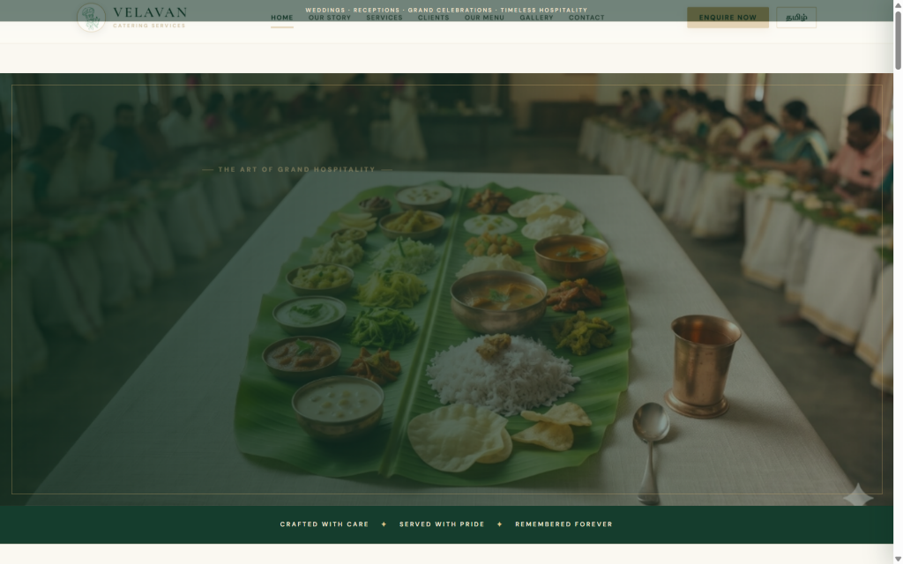
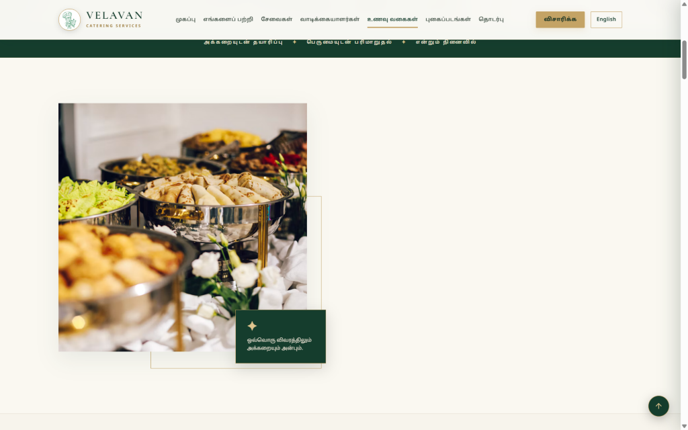
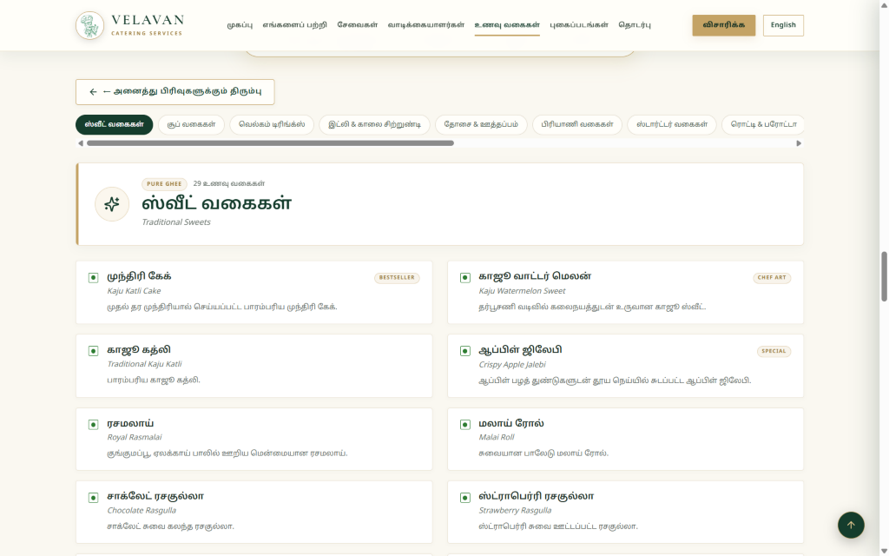
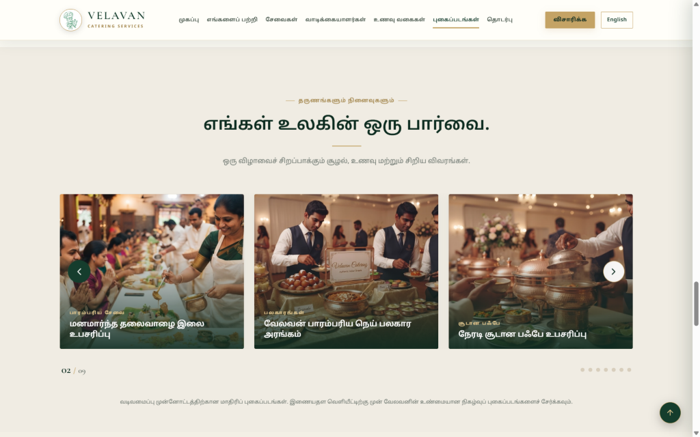
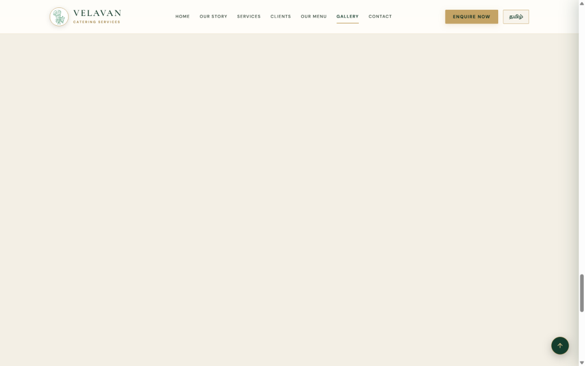
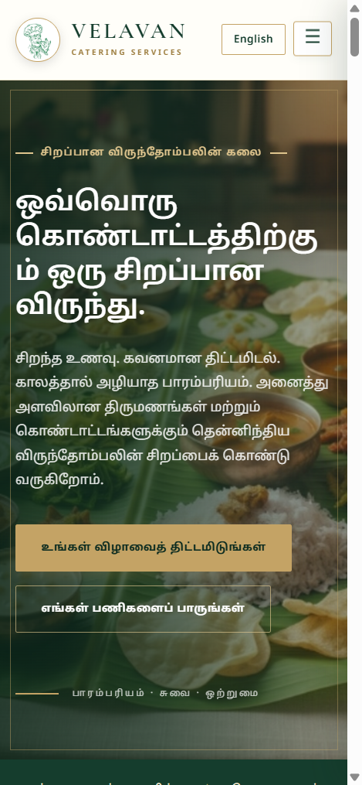

# Velavan Catering Services

<p align="center">
  
</p>

<p align="center">
  <strong>A Premium Catering Website | Coimbatore, Tamil Nadu</strong>
</p>

<p align="center">
  A modern, responsive website developed for Velavan Catering Services to showcase catering offerings, present food menus, highlight memorable events and make customer enquiries easier.
</p>

---

### About the Project

Velavan Catering Services is a catering business website designed to provide customers with an elegant and convenient way to explore catering services and event offerings.

The website focuses on presenting the brand, showcasing catering services, displaying menu categories, sharing event photographs and providing a simple enquiry experience.

The platform supports both English and Tamil, making the website accessible to a wider audience.

---

### Website Preview

- **Live Website:** Production deployment ready via Netlify (`netlify.toml`) and Vercel. Local preview runs at `http://localhost:3000`.
- **GitHub Repository:** [https://github.com/axytechh-03/velavan-catering-services](https://github.com/axytechh-03/velavan-catering-services)

---

### Key Features

#### 1. Home Page
- Premium hero section featuring authentic South Indian feast and celebration photography.
- Clear brand presentation with the official chef emblem and brand badge.
- Introductory tagline, service overview, and direct action call-to-action buttons (*Explore Menu* and *Enquire Now*).
- Fluid responsive layout tailored for all screen resolutions.

#### 2. About / Our Story
- Introduction to Velavan Catering Services and its heritage of culinary excellence.
- Brand story highlighting traditional preparation techniques, pure ingredients, and timeless hospitality.
- Dedicated visual presentation honouring the brand legacy and guiding values.

#### 3. Catering Services
Showcases 6 core catering service offerings with bespoke menu highlights and dedicated photography:
- **Wedding & Muhurtham Catering (`திருமண & முகூர்த்த விருந்து`):** Traditional Tamil plantain leaf feast featuring ghee-roasted delicacies, traditional sambar, poriyal, kootu, vadai, and hot payasam served from brass urulis.
- **Wedding Reception Catering (`திருமண வரவேற்பு விருந்து`):** Grand reception buffets with live tawa stations, Dum Seeraga Samba Biryani, special dosas, and dessert counters.
- **Engagement Catering (`நிச்சயதார்த்த விருந்து`):** Auspicious Nichayathartham and Thamboolam celebrations featuring refreshing welcome drinks, traditional sweets, and celebratory banquets.
- **Corporate Events (`கார்ப்பரேட் & வணிக நிகழ்வுகள்`):** Thoughtfully prepared menus for executive dinners, annual meetings, conferences, and office celebrations.
- **Birthday Celebrations & Family Functions (`பிறந்தநாள் & குடும்ப விசேஷங்கள்`):** Customised menus and warm hospitality making milestone birthdays and family gatherings memorable.
- **Special Events & Occasions (`சிறப்பு நிகழ்வுகள் & விசேஷங்கள்`):** Tailored culinary spreads crafted for temple celebrations, housewarmings, anniversaries, and community gatherings.

#### 4. Clients Section
- Dedicated showcase highlighting corporate and institutional trust markers.
- Clean grid layout harmonised with the brand's aesthetic.

#### 5. Interactive Menu
- Complete catalog transcribed from the official prospectus across 14 comprehensive categories:
  - *Traditional Sweets, Aromatic Soups, Welcome Drinks, Idli & Morning Tiffin, Dosas & Live Roasts, Biryanis, Starters, Rotis & Breads, Rich Gravies, Chutneys & Sambars, Rice Specialties, Payasams, Feast Accompaniments, and Pickles & Beverages.*
- Real-time global dish search across categories matching in both English and Tamil.
- Interactive category drilldown view with visual category switching and pure vegetarian culinary tags.
- Detailed dish cards with Tamil translations and specialty badges.

#### 6. Moments & Memories Gallery
- Finite, non-repeating multi-slide carousel presenting celebration photography.
- In-boundary navigation controls with disabled state boundaries (`01 / 09` to `09 / 09`).
- Image pagination counter and interactive indicator dots.
- Touch swipe gesture support for mobile and tablet users.
- Modal lightbox dialog for high-resolution photograph viewing with full captions.

#### 7. Contact & Enquiry
- Structured 9-field customer enquiry form with real-time validation (phone, event date, guest count, and event type).
- Instant pre-filled WhatsApp direct messaging connecting customers to `+91 90803 09584`.
- Dual-mode submission: Supabase database sync with automatic local storage backup.

#### 8. Bilingual Experience
- Instant language toggle between English and தமிழ் (Tamil) across the entire platform.
- Zero page reload: preserves active search queries, selected menu category, and scroll position.
- Persistent language preference stored in `localStorage`.
- Calibrated Tamil typography for balanced readability on all devices.

#### 9. Responsive Design
- Optimized across desktop monitors (1440px, 1280px), laptops (1024px), tablets (768px), and mobile devices (430px, 390px, 375px, 360px, 320px).
- Zero horizontal overflow across all viewports.
- Touch-friendly tap targets and adaptive navigation headers.

#### 10. Additional Features
- Smooth scrolling navigation across all internal section anchors (`#home`, `#story`, `#services`, `#clients`, `#menu`, `#gallery`, `#contact`).
- Subtle micro-interactions, entrance animations, and hover transitions.
- Statutory business trust markers:
  - **MSME Udyam Registration**: `UDYAM-TN-03-0341714` (Micro Enterprise, Event Catering 56210).
  - **FSSAI Food Safety State License**: `12426003001273`.
- Password-protected administrative control centre (`/admin`) for enquiry lifecycle management and CSV export.

---

### Technology Stack

| Technology | Purpose |
| :--- | :--- |
| **Next.js 14** | Modern React framework with App Router, server-side rendering, and static generation |
| **React 18** | Component-based interactive user interface |
| **TypeScript 5** | Strict type safety and predictable development |
| **Tailwind CSS 3** | Utility-first styling framework |
| **Vanilla CSS** | Custom animations, responsive design system, and fine-tuned typography (`app/globals.css`) |
| **Lucide React** | Clean, accessible SVG iconography |
| **Framer Motion** | Lightweight UI transitions and scroll-linked entrance animations |
| **Supabase Client** | PostgreSQL database client for customer enquiry management |
| **Git & GitHub** | Version control, branch management, and repository source tracking |

---

### Project Structure

```text
velavan-catering-services/
├── app/
│   ├── admin/                    # Admin enquiry dashboard (/admin)
│   ├── api/
│   │   ├── admin/check/          # Admin authentication verification
│   │   ├── admin/login/          # Secure admin login endpoint
│   │   └── enquiry/              # Customer enquiry submission endpoint
│   ├── globals.css               # Global design tokens, animations, responsive rules
│   ├── layout.tsx                # Root layout with LanguageProvider and fonts
│   └── page.tsx                  # Main homepage section composition
├── components/
│   ├── common/
│   │   ├── BrandLoader.tsx       # Creative brand loading animation
│   │   └── ScrollAnimationProvider.tsx # Scroll observer provider
│   ├── layout/
│   │   ├── Footer.tsx            # Website footer, contact info, quick links
│   │   ├── Header.tsx            # Sticky navigation bar with mobile slide drawer
│   │   ├── LanguageToggle.tsx    # Bilingual switch component
│   │   └── TopBar.tsx            # Top announcement ticker
│   └── sections/
│       ├── Clients.tsx           # Institutional clients showcase
│       ├── Enquiry.tsx           # 9-field enquiry form and WhatsApp connect
│       ├── Gallery.tsx           # Moments & Memories finite animated carousel
│       ├── Hero.tsx              # Hero banner with primary CTAs
│       ├── MenuSection.tsx       # 14-category menu catalog with search & drilldown
│       ├── PromiseStrip.tsx      # Brand values marquee strip
│       ├── Registrations.tsx     # FSSAI license and MSME Udyam compliance cards
│       ├── Services.tsx          # 6 Core celebration service cards
│       ├── Story.tsx             # Culinary heritage and brand narrative
│       ├── Tribute.tsx           # Tribute to founder Jayanthi
│       └── Values.tsx            # Core pillars of hospitality and authenticity
├── context/
│   └── LanguageContext.tsx       # Global bilingual state management (en / ta)
├── data/
│   ├── gallery.ts                # Gallery photography metadata and captions
│   ├── menu.ts                   # 14-category prospectus menu dataset (240+ dishes)
│   ├── services.ts               # Service card offerings, guest counts, and dishes
│   └── translations.ts           # Complete bilingual translation dictionaries
├── docs/
│   └── screenshots/              # Real application documentation screenshots
├── lib/
│   ├── supabase.ts               # Supabase database client with fallback handling
│   └── utils.ts                  # Shared helper utilities
├── public/
│   ├── favicon.ico
│   ├── icon-192.png
│   └── images/
│       ├── founder/              # Founder portrait photograph
│       ├── gallery/              # 9 celebration photographs (gallery-1.jpg - gallery-9.jpg)
│       ├── hero/                 # Hero background photography
│       ├── logo/                 # Official Velavan brand logo assets
│       └── services/             # 6 Celebration service photographs
├── supabase/
│   └── migrations/               # Database schema and Row-Level Security policies
├── .env.example                  # Environment variable configuration template
├── .gitignore                    # Exclusions for build artifacts, secrets, and caches
├── netlify.toml                  # Netlify deployment configuration
├── next.config.mjs               # Next.js compiler configuration
├── package.json                  # Dependencies and execution scripts
├── postcss.config.js             # PostCSS plugins
├── tailwind.config.ts            # Tailwind CSS configuration
└── tsconfig.json                 # TypeScript compiler configuration
```

---

### Getting Started

Follow these instructions to run the project locally.

#### Prerequisites
- **Node.js**: `v18.17.0` or higher
- **npm**: `v9.0.0` or higher
- **Git**: Installed and configured

#### 1. Clone the repository
```bash
git clone https://github.com/axytechh-03/velavan-catering-services.git
```

#### 2. Navigate to the project directory
```bash
cd velavan-catering-services
```

#### 3. Install dependencies
```bash
npm install
```

#### 4. Configure environment variables
Copy the environment template:
```bash
cp .env.example .env.local
```
*(Optionally populate your Supabase URL and key in `.env.local` if testing database synchronization. Fallback local storage works out of the box).*

> Never commit `.env.local`, API keys, passwords, or credentials to GitHub.

#### 5. Start the development server
```bash
npm run dev
```

Open your browser and navigate to:
```text
http://localhost:3000
```
To view the admin control panel, visit:
```text
http://localhost:3000/admin
```

---

### Production Build

To test or prepare for production deployment:

```bash
# Build the application
npm run build

# Start the production server
npm run start
```

---

### Design Approach

The website follows a premium South Indian catering brand identity rooted in tradition and warmth.

#### Visual Direction
- **Royal Green (`#0a2a1b`, `#153d2d`):** Primary brand colour representing auspicious banana leaves and prosperity.
- **Ivory & Cream (`#faf8f1`, `#f5f0e3`):** Clean backgrounds reminiscent of traditional silk veshtis.
- **Muted Gold (`#c4a365`):** Subtle accents reflecting festive brass lamps and auspicious celebrations.
- **Serif & Clean Sans Typography:** Cormorant Garamond for elegant headings and Noto Sans Tamil / DM Sans for clear bilingual legibility.

#### User Experience
- Simple, intuitive single-page navigation with persistent header.
- Clear service presentation with guest capacities and sample menu highlights.
- Instant dish search across all 14 categories.
- Frictionless enquiry submission with direct WhatsApp connectivity.
- Responsive design tailored across all mobile, tablet, and desktop viewports.

---

### Responsive Compatibility

The website is engineered and verified for consistent performance across:
- **Mobile Phones**: iPhone SE (320px), Galaxy S8 (360px), iPhone 13 mini (375px), iPhone 14/15 (390px), iPhone Pro Max (430px)
- **Tablets**: iPad Portrait (768px), iPad Pro / Surface (1024px)
- **Laptops & Desktops**: Standard HD (1280px, 1366px), Full HD & Retina (1440px+)

Responsive behaviour applies to header navigation, service card grids, menu filters, carousel arrow controls, form inputs, and typography wrapping.

---

### Screenshots

Real application screenshots captured from the running website:

#### 1. Homepage & Hero Section


#### 2. Catering Services


#### 3. Interactive Menu & Search


#### 4. Moments & Memories Gallery


#### 5. Contact & Enquiry Form


#### 6. Mobile Experience & Responsive Navigation


---

### Repository Information

| Detail | Information |
| :--- | :--- |
| **Project** | Velavan Catering Services |
| **GitHub Owner** | `axytechh-03` |
| **Repository** | `velavan-catering-services` |
| **Default Branch** | `main` |
| **Visibility** | Private |

**Repository URL:**  
[https://github.com/axytechh-03/velavan-catering-services](https://github.com/axytechh-03/velavan-catering-services)

---

### Maintenance & Updates

This repository contains the authoritative source code and documentation for the Velavan Catering Services website.

The README is maintained whenever significant changes are made to:
- Website features and offerings.
- Technology stack and library versions.
- Project folder hierarchy and file organisation.
- Installation scripts and environment variables.
- Statutory registrations and business details.

---

### Developed With Care

**Velavan Catering Services**  
Website design and development repository maintained by **AXY Technologies**.
